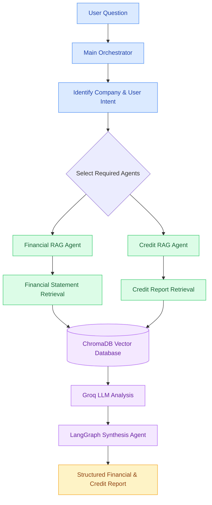
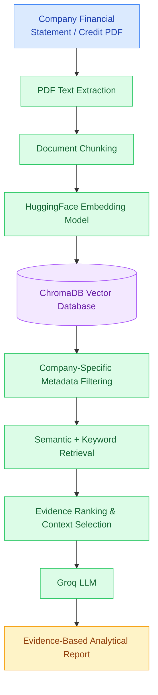

# Multi-Agent Credit AI

### An Agentic AI Framework for Corporate Financial Analysis and Credit Risk Assessment

A Python-based multi-agent application that uses **Large Language Models (LLMs), Retrieval-Augmented Generation (RAG), LangGraph, and ChromaDB** to analyze corporate financial statements and credit reports.

The system coordinates specialized AI agents to retrieve company-specific information, interpret financial and credit evidence, and generate structured analytical reports.

**Project Status:** Research prototype / Work in progress

---

## 1. Project Overview

Traditional corporate credit analysis requires analysts to review financial statements, credit reports, and other supporting documentation.

This project explores how an agentic AI architecture can support that process through document retrieval, specialized analysis, and automated report generation.

The application supports:

- Company registration and document onboarding
- PDF extraction and document chunking
- Vector embeddings and semantic search
- Financial statement analysis using RAG
- Credit report analysis using RAG
- Intelligent agent selection and orchestration
- Evidence-based report synthesis
- Company-specific document filtering

## 2. System Architecture




           STRUCTURED REPORT


The orchestration layer uses LangGraph to route tasks to relevant agents and combine their findings.

## 3. Technology Stack

| Technology | Purpose |
|---|---|
| Python | Core application development |
| LangGraph | Multi-agent orchestration |
| LangChain | LLM and retrieval integration |
| Groq API | LLM inference |
| GPT-OSS 120B | Language model used for analysis |
| ChromaDB | Vector database |
| HuggingFace Embeddings | Document vectorization |
| all-MiniLM-L6-v2 | Embedding model |
| PyPDFLoader | PDF text extraction |
| Pydantic | Structured agent decisions |
| Ubuntu / WSL2 | Development environment |

## 4. Project Components

**`orchestrator.py`**

Identifies the company, interprets the user's question, and determines which specialized agents should run.

**`universal_rag.py`**

Implements company-specific document retrieval and LLM-based analysis for financial statements and credit reports.

**`multi_agent_workflow.py`**

Defines the LangGraph workflow, agent routing, and synthesis of findings.

**`document_indexer.py`**

Extracts PDF text, splits documents into chunks, generates embeddings, and indexes them in ChromaDB.

**`document_registry.py`**

Registers available documents for each company.

**`document_validator.py`**

Checks whether indexed financial statements and credit reports are available.

**`company_registry.py`**

Maintains the company registry.

**`onboard_company.py`**

Provides a command-line workflow for onboarding company documents.

## 5. Document Processing Pipeline





Documents are tagged with company identifiers and document metadata to support company-specific retrieval.

## 6. Installation

### Prerequisites

- Python 3.11 or newer
- Git
- Groq API key
- Internet access for initial model downloads and API inference

### Clone the repository

```bash
git clone https://github.com/rohanksingh/multi-agent-credit-ai.git
cd multi-agent-credit-ai
```

### Create a Python virtual environment

```bash
python3 -m venv venv
source venv/bin/activate
```

On Windows PowerShell, use `venv\Scripts\Activate.ps1` instead.

### Install dependencies

If a `requirements.txt` file is included:

```bash
pip install -r requirements.txt
```

### Configure the API key

Create a `.env` file in the project root:

```env
GROQ_API_KEY=your_groq_api_key_here
```

**Security:** Never commit API keys, `.env` files, private credit reports, or confidential financial information to GitHub.

## 7. Company Document Onboarding

The application supports onboarding financial statements and credit reports for different companies.

Example:

```bash
python onboard_company.py \
  --company-id DEMO_CORP \
  --company-name "Demo Corporation" \
  --type financial \
  --pdf /path/to/financial_report.pdf
```

The onboarding process registers the company, copies the PDF into the appropriate local directory, and indexes its contents.

The application expects a local document structure similar to:

```text
data/
  companies/
    DEMO_CORP/
      financial/
        financial_report.pdf
      credit/
        credit_report.pdf
```

The vector database and uploaded documents are stored locally and are not required to be committed to the public repository.

## 8. Example Usage

### Financial statement analysis

```python
from universal_rag import universal_rag_agent

response = universal_rag_agent(
    question="What are the company's revenue and operating income?",
    company_id="DEMO_CORP",
    document_type="financial"
)

print(response)
```

### Credit report analysis

```python
from universal_rag import universal_rag_agent

response = universal_rag_agent(
    question="Evaluate the company's credit risk.",
    company_id="DEMO_CORP",
    document_type="credit"
)

print(response)
```

These examples require the corresponding company documents to be onboarded and indexed first.

## 9. Multi-Agent Workflow

The complete workflow includes:

1. **Orchestrator:** Identifies the company and selects the appropriate agents.
2. **Document Validator:** Checks the availability of indexed documents.
3. **Financial RAG Agent:** Retrieves and analyzes financial statement evidence.
4. **Credit RAG Agent:** Retrieves and analyzes credit report evidence.
5. **Synthesis Agent:** Combines available findings into a structured report.

Depending on document availability and user intent, the workflow can invoke one or both specialized agents.

## 10. Analytical Outputs

The application is designed to produce reports containing:

- Executive summary
- Financial or credit findings
- Key metrics and indicators
- Risk observations
- Missing evidence
- Overall assessment
- Recommended next steps

Outputs depend on the quality, completeness, and relevance of the retrieved source documents.

## 11. Current Limitations

This project is an evolving research prototype.

Known limitations include:

- Retrieval may fail to select relevant financial-statement passages even when they exist in the vector database.
- Complex financial tables may not be extracted or interpreted reliably.
- LLM responses require verification against original documents.
- Groq API rate limits and context limits may affect execution.
- Credit analysis is exploratory and has not been validated as a production-grade risk model.
- The application currently uses local document storage and requires configuration before use.

The system should not be used as the sole basis for lending, investment, or other consequential financial decisions.

## 12. Future Enhancements

Potential improvements include:

- More accurate hybrid retrieval and evidence reranking
- Structured extraction of financial tables
- Automated financial ratio calculations
- Retrieval evaluation and source-citation validation
- Improved credit risk scoring and explainability
- Automated testing and performance benchmarking
- Web-based user interface
- Containerized deployment
- Support for additional document types

## 13. Research Objective

The broader objective is to investigate how agentic AI and retrieval-augmented language models can improve the efficiency, transparency, and consistency of corporate financial and credit analysis.

The project also provides a foundation for exploring document-grounded reasoning, multi-agent collaboration, and automated analytical workflows.

## 14. Disclaimer

This repository is intended for educational, research, and demonstration purposes.

AI-generated financial and credit analyses may contain errors or omissions and must be independently verified. No output should be interpreted as professional financial, investment, or lending advice.
